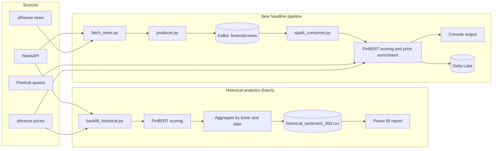
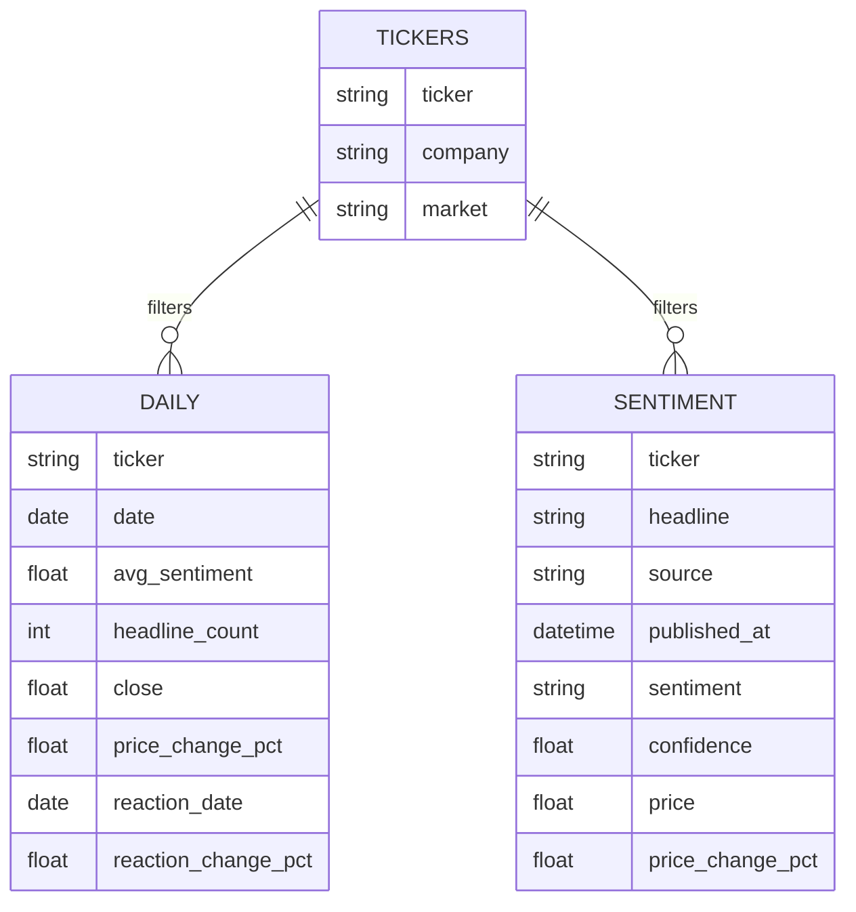
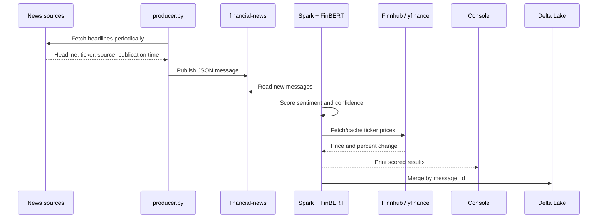

# BrandPulse

BrandPulse is a financial news and market sentiment analytics project. It collects business headlines for selected US and Indian companies, classifies each headline with FinBERT, enriches ticker-tagged news with stock prices, and presents sentiment and price trends in Power BI.

The project has two related workflows:

- **Historical analytics:** a batch backfill creates daily headline/sentiment/price aggregates for analysis in Power BI.
- **Streaming pipeline:** Kafka and Spark process newly fetched headlines, print live sentiment and price results in the console, and persist the scored records to Delta Lake.

> **Dashboard data status:** Power BI analytics currently use past data and imported snapshots. Live dashboard updates are planned but are not implemented. Newly arriving live results can be seen in the producer/Spark console output; the streaming pipeline does not automatically refresh the Power BI report.

## What BrandPulse does

1. Retrieves financial headlines from NewsAPI and Yahoo Finance (`yfinance`).
2. Adds source, ticker, publication time, and ingestion metadata.
3. Uses FinBERT (`ProsusAI/finbert`) to classify each headline as positive, negative, or neutral and calculate confidence.
4. Looks up ticker prices (Finnhub for US tickers and `yfinance` for Indian exchange tickers), with a local cache.
5. Aggregates historical sentiment and price movement by ticker and day.
6. Presents the historical analysis in Power BI and displays streaming results in the console.

The project covers US tickers such as `AAPL`, `TSLA`, `NVDA`, `MSFT`, and `AMZN`, along with Indian tickers such as `RELIANCE.NS`, `TCS.NS`, `INFY.NS`, and `HDFCBANK.NS`.

## Architecture



The historical and streaming paths are intentionally separate. The Power BI report is for historical analysis; the Kafka/Spark branch is for processing incoming data and observing live results. Delta Lake stores the streaming output but is not currently connected to an automatic Power BI refresh.

## Workflow

### 0. Prepare the Python environment

Use a Python environment with Java 17 or 21 available for Spark. Install the libraries used by the scripts:

```powershell
python -m pip install pandas torch transformers yfinance python-dotenv newsapi-python requests kafka-python pyspark==4.1.3 delta-spark==4.3.0
```

FinBERT can run on CPU; a compatible CUDA-enabled PyTorch install can accelerate model inference when a supported GPU is available.

### 1. Configure data access

Create a `.env` file in the project root. Keep it private; `.env` is ignored by Git.

```dotenv
NEWSAPI_KEY=your_newsapi_key
FINNHUB_API_KEY=your_finnhub_key
```

`NEWSAPI_KEY` is required by the news fetch and historical backfill scripts. `FINNHUB_API_KEY` is used for US live price lookups; without it those lookups are skipped. Indian ticker price lookups use `yfinance`.

### 2. Build the historical analytics dataset

Run the backfill to retrieve up to 30 days of ticker-tagged news and daily prices, score the headlines, and write the daily aggregate:

```powershell
python backfill_historical.py
```

The output is `historical_sentiment_30d.csv` in the project directory. It contains one row per ticker and date, including:

| Column | Meaning |
|---|---|
| `ticker`, `date` | Company ticker and calendar date |
| `avg_sentiment` | Daily confidence-weighted score: positive = `+1`, negative = `-1`, neutral = `0` |
| `headline_count`, `headlines` | Number of unique headlines and their text |
| `close`, `price_change_pct` | Closing price and daily percent movement |
| `is_trading_day` | Whether a closing price was available for that date |
| `reaction_date`, `reaction_change_pct` | Next trading-session date and move, useful for headlines published on non-trading days |

The backfill uses NewsAPI's available recent-history window and yfinance daily price history. Results depend on source availability and API limits. This generated CSV is ignored by Git, so regenerate it locally when needed.

### 3. Explore the data in Power BI

Load the historical data snapshot into Power BI and use the ticker, daily aggregate, and headline-level sentiment fields to explore the results. The report is organized into two pages:

#### Sentiment vs Price

- Filter by ticker.
- Review daily headline count, average sentiment, close, and price movement.
- Compare average daily sentiment with price change over time.
- Inspect monthly/daily headline volume.
- Compare average sentiment and price change across tickers.

#### News Analysis

- Filter by market and news source.
- Compare headline counts by ticker and sentiment.
- Browse individual headlines with sentiment labels and confidence.
- Review headline-count, average-confidence, average-sentiment, and positive/negative-share summaries.

The report model uses a ticker dimension (`ticker`, `company`, `market`) related to the daily and sentiment data:



The backfill CSV supplies the daily aggregate fields. The headline-level table shown in the report model is a separate set of scored headline records; the aggregate CSV alone does not contain one sentiment/confidence row per headline.

Refresh or replace the imported historical snapshot to analyze a newer period. This is a manual/historical-data workflow today; dashboard refreshes driven by the live stream are planned, not implemented.

### 4. Start Kafka

Docker Desktop (or another Docker Engine) must be running. From the project root:

```powershell
docker compose up -d
```

The Compose file starts a single-node Kafka broker and exposes it on `localhost:9092`. Confirm that it is healthy before starting the Spark consumer or producer.

### 5. Start the Spark streaming consumer

The streaming job requires Java 17 or 21, a compatible Windows Hadoop setup (`HADOOP_HOME` and `winutils.exe`), and the Python environment configured for PySpark. The job downloads/loads the FinBERT model the first time it is run if it is not already cached.

From the project root, launch Spark with the Kafka and Delta connectors used by the pipeline:

```powershell
spark-submit --packages org.apache.spark:spark-sql-kafka-0-10_2.13:4.1.3,io.delta:delta-spark_4.1_2.13:4.3.0 spark_consumer.py
```

The consumer subscribes to `financial-news` and starts from the latest Kafka offsets. It scores each micro-batch, enriches ticker-tagged headlines with prices, prints results and status messages to the console, and writes deduplicated records to Delta Lake. Spark's checkpoint keeps track of streaming progress.

### 6. Start the headline producer

In a second terminal, with the same Python environment active:

```powershell
python producer.py
```

The producer fetches headlines from NewsAPI and yfinance about once per minute, removes headlines already sent during the current process, and publishes JSON messages to Kafka. The Spark terminal then shows the incoming live sentiment and price-enrichment results. Press `Ctrl+C` to stop either process.

### 7. Stop Kafka

When finished:

```powershell
docker compose down
```

## Streaming message and storage

Producer messages include fields such as `headline`, `ticker`, `source`, `published_at`, `message_id`, and `ingested_at`. Spark adds `sentiment`, `confidence`, `price`, `price_change_pct`, and `price_status`.



The Delta output is written beneath `delta/sentiment`; streaming offsets/checkpoint state are stored beneath `checkpoints/sentiment`. These are generated local data and state directories, not Power BI live-refresh endpoints.

## Project files

| File or directory | Purpose |
|---|---|
| `fetch_news.py` | Fetches and deduplicates current headlines from NewsAPI and yfinance |
| `fetch_price.py` | Retrieves and caches ticker prices, routing US and Indian symbols to their sources |
| `producer.py` | Publishes fetched headlines to Kafka |
| `spark_consumer.py` | Reads Kafka messages, scores sentiment, enriches prices, prints results, and stores Delta records |
| `backfill_historical.py` | Builds the historical daily sentiment/price CSV |
| `historical_sentiment_30d.csv` | Generated historical aggregate used for past-data analysis |
| `docker-compose.yml` | Local Kafka broker configuration |
| `delta/sentiment/` | Generated Delta Lake streaming output |
| `checkpoints/sentiment/` | Generated Spark Structured Streaming checkpoint |
| `Initial_Testing/` | Earlier pipeline experiments and prototypes |

## Notes and limitations

- A headline's sentiment describes FinBERT's classification of the text; it is not investment advice or a prediction of future returns.
- Broad market headlines may not have a ticker and are therefore not price-enriched.
- Price values can be cached or stale when a live lookup is unavailable. The stream labels price status accordingly.
- The Power BI analytics are based on past/imported data. Live ingestion is visible in the console, and the Spark job also persists streaming records to Delta Lake, but live dashboard updates are not implemented yet.
- `spark_consumer.py` currently uses local Windows paths for its Delta output and checkpoint. Update `DELTA_PATH` and `CHECKPOINT_PATH` in that file when running from a different checkout location or operating system.
